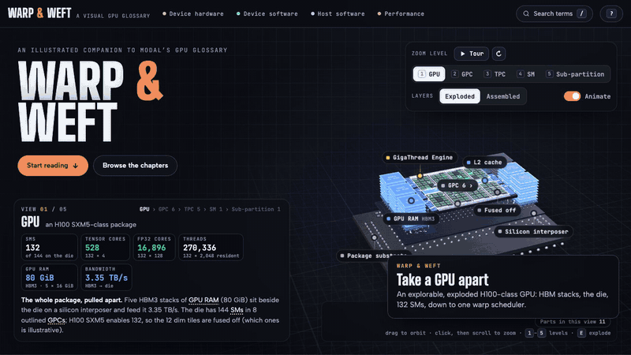

# Warp & Weft

  

<b>Every term in <a href="https://modal.com/gpu-glossary">Modal's GPU Glossary</a>, drawn out and made to move.</b> 
85 entries · 317 interactive figures · one explorable 3D GPU · no install, no build

An illustrated, interactive companion to Modal's GPU Glossary. It covers every page of the glossary,
from Streaming Multiprocessors and Tensor Cores to PTX, occupancy and bank conflicts, and turns each
one into figures you can operate. This is an independent, unofficial project, not affiliated with or
endorsed by Modal or NVIDIA.

## What you can do with it

- **Take a GPU apart in 3D.** An exploded H100-class GPU: HBM stacks, the interposer, the die with its
  132 SMs, then zoom level by level to a single SM sub-partition, with live counts at every level.
- **See each mechanism run.** Step through a Tensor Core matrix multiply, a systolic array, warp
  scheduling cycle by cycle, a divergent branch lane by lane, the compiled SASS of the glossary's own
  kernels.
- **Change a parameter and watch the hardware respond.** Stride a warp's loads and count DRAM bursts,
  pick an access pattern and see shared-memory bank conflicts, resize thread blocks and see occupancy.
- **Get real numbers from live calculators.** Roofline (A100, H100, B200 presets), occupancy, peak rate,
  Little's law, latency hiding, LLM inference latency. Every readout is computed, never hard-coded.
- **Learn one picture, see it everywhere.** Shared diagrams (the H100 SM floorplan, the programming
  model ↔ hardware map, the CUDA toolkit stack, the roofline, the warp-cycle grid) recur across entries
  in one consistent colour code: cores green, other units pink, scheduling amber, memory blue.
- **Read it as hypertext, like the original.** Every cross-link previews its target on hover; search
  covers the whole site; `→` / `←` walk the glossary in order; each entry links back to its Modal page.
- **Trust the numbers.** Nothing from the glossary is left out. Added context is marked
  "Beyond the glossary", and every place where a figure was recomputed is marked "Checked the math".

## Where the content comes from

The source of everything this site explains is the **[GPU Glossary](https://modal.com/gpu-glossary)
by [Modal](https://modal.com)**, written by Charles Frye with the people listed on its
[Contributors](https://modal.com/gpu-glossary/contributors) page, and published under
[CC BY 4.0](https://creativecommons.org/licenses/by/4.0/) at
[github.com/modal-labs/gpu-glossary](https://github.com/modal-labs/gpu-glossary).

- **Taken from the glossary:** the list of entries and their order, every concept, fact, number,
  worked example, caveat and aside, every glossary reference link, and all code samples. Code samples
  (CUDA C++, PTX, SASS, Python, BASIC, `nvidia-smi` output, tables) are reproduced verbatim, as are
  passages marked as quotes. Each entry opens with the glossary's one-line definition (or a close restatement of
  it) and ends with a link to the original glossary page.
- **Written for this site:** the explanatory prose, which restates and expands the glossary in new words
  for newcomers, and every figure. The glossary's diagrams were redrawn as interactive illustrations;
  none of its image files are displayed.
- **Added beyond the glossary:** context in notes labelled **"Beyond the glossary"** (for example H100
  die configuration from NVIDIA's whitepaper), and notes labelled **"Checked the math"** where a
  number was recomputed and differs from the glossary's text. Everything else is the glossary's material.

[REFERENCES.md](REFERENCES.md) lists the glossary page behind each of the 85 entries, all 209
references the glossary cites (every one appears on the site), and the 44 additional references this
site cites for its added context.

## Viewing it

- Open `warp-weft-standalone.html` in a browser. It is the whole site in one file.
- Or open `index.html`, which loads the same site from `assets/`.

Both work straight from disk; no server or build step is needed. An internet connection is used for
the web fonts and for Three.js; without it the 3D model falls back to a static title.

Keys: `→` / `←` walk the glossary in order, `/` searches, `?` lists the shortcuts.

## Project layout

| Path | What it is |
|---|---|
| `index.html`, `assets/css/gg.css`, `assets/js/core.js` | Page shell, design system and runtime |
| `assets/js/terms.js` | The glossary's entries, in its order |
| `assets/js/components/` | Shared diagrams: the H100 SM floorplan, programming model ↔ hardware map, CUDA toolkit stack, roofline, warp-cycle grid |
| `assets/js/chapters/` | The explanations and figures, one file per group of entries |
| `assets/js/hero.js` | The 3D exploded GPU |
| `warp-weft-standalone.html` | Single-file build of all of the above |
| `tools/bundle.py` | Rebuilds the single file: `python3 tools/bundle.py` |
| `docs/demo.gif` | The tour at the top of this README, recorded from the site itself |

## Credits

- **Content:** Modal's [GPU Glossary](https://modal.com/gpu-glossary) and its
  [contributors](https://modal.com/gpu-glossary/contributors), CC BY 4.0. See above and
  [REFERENCES.md](REFERENCES.md).
- **Diagrams in the glossary** that the figures here are based on are themselves adapted by Modal from
  NVIDIA's white papers and documentation, Fabien Sanglard's history of NVIDIA GPUs, the *Professional
  CUDA C Programming* book, NVIDIA's GTC 2025 talks, and Williams, Waterman and Patterson (2008).
  All of these are listed in REFERENCES.md.
- **Library:** [Three.js](https://threejs.org) r128 (MIT), loaded from cdnjs.
- **Fonts:** Big Shoulders Display, Albert Sans and JetBrains Mono (SIL Open Font License), from
  Google Fonts.
- NVIDIA, CUDA, H100 and related names are trademarks of NVIDIA Corporation.

## License

- **Code** (HTML, CSS, JavaScript and `tools/`): MIT. See [LICENSE](LICENSE).
- **Content** (the explanatory text adapted from the GPU Glossary, the reproduced code samples and
  quotes, and the figures based on its diagrams):
  [Creative Commons Attribution 4.0 International](https://creativecommons.org/licenses/by/4.0/),
  the same license as the original. If you reuse it, credit Modal's GPU Glossary and this project.
